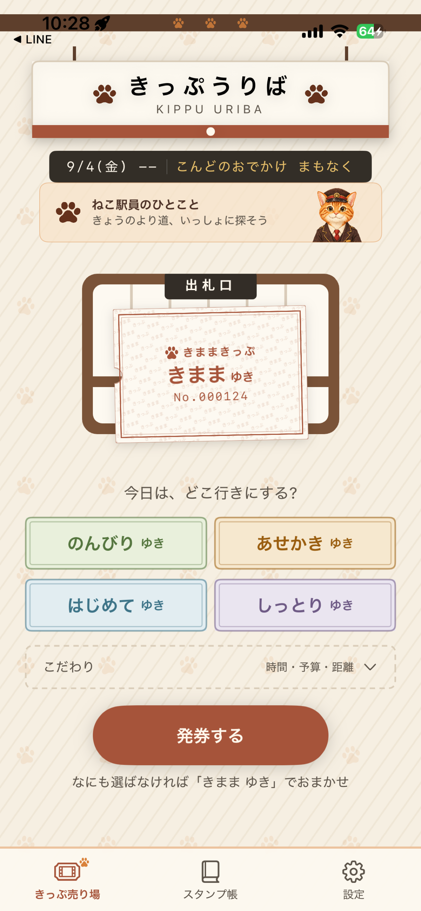

# きままきっぷ — 近くのおでかけ提案

「今日はどこへ行こう？」と迷った日に、気分に合う近場のおでかけ候補を、駅の切符のように受け取れるiPhoneアプリです。

**個人開発：企画・UI/UXデザイン・開発を担当**

[App Storeで見る](https://apps.apple.com/jp/app/id6808109602) · [サポートサイト](https://otomoyuki1120-sudo.github.io/kimama-kippu-site/)

> このリポジトリは作品紹介用です。アプリ本体のソースコードは公開していません。

## 画面

*App Storeに掲載している画面画像。実際の表示は端末やアプリのバージョンによって異なります。*

## できること

- 「のんびり」「あせかき」「はじめて」「しっとり」など、その日の気分から行き先を探す。
- 時間・予算・移動の条件を選び、おでかけ候補を一枚の「きっぷ」として発券する。
- 発券したきっぷをスタンプ帳で振り返る。
- 位置情報や通信が使えない場合にも、アプリ内の候補から発券を続けられるようにする。

## 制作で意識したこと

- 行き先を決める作業を、検索結果の一覧ではなく「切符を受け取る」体験にした。
- 券売場、券面、スタンプ帳を、猫駅員・紙の色・肉球の模様で一つの世界観につないだ。
- 周辺候補の取得にはMapKit、天気情報にはOpen-Meteoを活用しつつ、外部サービスに接続できないときの候補も用意した。

**主な技術：** SwiftUI、MapKit、Core Location、Open-Meteo

## 履歴書向けの紹介文

> きままきっぷ（iPhoneアプリ）を個人開発。企画・UI/UXデザイン・開発を一貫して担当し、気分や時間・予算・移動条件に合わせて近場のおでかけ候補を切符として提案する体験を制作。App Storeで公開中。

公開版と作品の詳細は[App Store](https://apps.apple.com/jp/app/id6808109602)をご覧ください。
